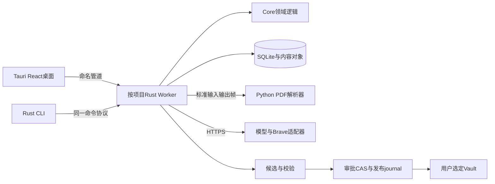

# Noetome V1 工程架构

状态：B01-T00固定的实施蓝图，覆盖[PRD](../requirements/PRD.md)全部V1 P0，不表示已实现或已通过测试。任务按[ROADMAP](../execution/ROADMAP.md)逐项落地，不由执行者重新选栈。库及版本策略见[STACK](STACK.md)，领域与SQL以[DATA_CONTRACTS](DATA_CONTRACTS.md)和[schema.sql](schema.sql)为准，默认值只在[CONFIG](CONFIG.md)维护。

## 1 进程与信任边界



- 一个项目一个按需启动的`noetome worker`进程，CLI与桌面共用。不注册Windows服务、不随系统登录自启、不运行本地HTTP服务。
- Worker是项目唯一写者，负责调度、预算、对象存储及发布。Python和React不访问SQLite；UI不能绕过审批写Vault。
- Rust处理领域语义；Python仅解析指定来源，返回候选结构和资源，不选择目标、不调用模型、不写数据库或Vault。
- 模型输出和网页都是不可信数据。模型只提交结构化候选，不能执行工具、改配置、决定自身验收或创建文件路径。
- Tauri Rust壳负责可信本地能力，React只发白名单命令。预览禁用远程资源、脚本及可执行URL；密钥不进入WebView。
- 图表与公式使用已有WebView2及离线Mermaid/MathJax。产品不附加Node/Chromium渲染侧车。CLI完成结构与语义检查，视觉状态单独记录。

## 2 固定代码结构与依赖方向

```text
Cargo.toml / Cargo.lock / rust-toolchain.toml
crates/
  noetome-core/src/
    ids.rs errors.rs canonical.rs
    contracts.rs text_source.rs scheduler.rs budget.rs
    extraction.rs reconcile.rs planning.rs render.rs ...  # 具体模块见任务卡
    ports/
  noetome-store/src/
    sqlite/ migrations/ repositories/ objects/ journal/
  noetome-adapters/src/
    parser/ model/ research/ filesystem/ credentials/ ipc/ clock/
  noetome-cli/src/
    main.rs commands/ worker/ reports/
apps/desktop/
  package.json pnpm-lock.yaml tsconfig.json vite.config.ts
  src/App.tsx src/pages/ src/components/ src/lib/ src/styles/ src/tests/
  src-tauri/tauri.conf.json src-tauri/capabilities/ src-tauri/src/
  test/e2e/ wdio.conf.ts
sidecar/parser/
  pyproject.toml uv.lock .python-version
  src/noetome_parser/ tests/ packaging/
schemas/ tests/fixtures/ tests/benchmarks/ scripts/ doc/ dev-log/
```

| 边界 | 唯一职责 | 允许依赖 |
| --- | --- | --- |
| noetome-core | 类型、纯变换、验证器、预算/Job/发布状态机、端口trait | serde等纯库；无HTTP/SQLite/平台文件API |
| noetome-store | 迁移/事务/仓储、不可变对象、journal持久化 | core、rusqlite、文件IO；不调用API |
| noetome-adapters | PDF协议、HTTPS、凭据、Windows句柄与IPC | core及平台库；不越过仓储写SQL |
| noetome-cli | Composition root、worker生命周期、命令/报告、端口装配 | 上述三crate |
| desktop src-tauri | worker启动/连接、对话框、托盘、安全URL打开 | 管道客户端、Tauri；不另写领域规则 |
| desktop React | 页面状态、差异/证据/报告/预览 | 生成的协议类型；无任意shell及数据库权限 |

JSON Schema是B02-T01必须提交的跨语言规范，Rust serde类型为核心实现；B14-T01使用json-schema-to-typescript 15从Schema生成TS类型，fixture往返校验，CI检查生成差异。不能维护三套互不校验的定义。固定文件为schemas/ir.schema.json、config.schema.json、model-candidate.schema.json、ipc.schema.json；模型/配置/协议文档规定字段语义。具体实现文件以任务卡outputs为准，逻辑子域不要求各自再建目录。前端仅apps/desktop一个pnpm项目及锁文件。

## 3 项目与Vault布局

项目位于用户选定的本机NTFS普通目录；数据库与运行对象不能放网络共享或云同步活动目录。SQLite WAL不适用于网络文件系统，不能把跨主机共享作为支持场景。同步路径检测能力有限时如实显示检测结果，要求选择普通本地工作目录。[SQLite WAL](https://sqlite.org/wal.html)

```text
<project>/
  project.json
  state/noetome.sqlite3          # WAL/SHM同目录，不手工复制在用数据库
  state/worker.lock             # OS独占句柄，文件存在不等于锁生效
  objects/sha256/<前两位>/<完整sha256>
  staging/<run-id>/<plan-id>/
  publications/<release-id>/    # manifest、journal、审批快照
  backups/database/<timestamp>/
  logs/                         # 脱敏结构化日志
  reports/<run-id>/             # JSON及Markdown报告
  tmp/<job-id>/                 # 限额侧车输出
```

`project.json`顶层固定为`identity`与`config`。identity包含project_id、created_at、storage_schema_version；config字段以CONFIG为准，数据库配置流的config_id使用project_id，不向配置JSON添加未声明字段。配置文件与DB同revision指纹不一致时拒绝继续写入。密钥只保存Windows Credential Manager引用。

应用数据默认位于`%LOCALAPPDATA%/Noetome/`，含settings.json、webview-profile及脱敏启动日志；安装文件与项目数据分离。正常启动参数`--data-dir <dir>`将这三项整体移到指定普通本地目录，用于独立配置和自动测试；不改变project.json的位置，不更改系统APPDATA环境，不读取另一个数据目录中的密钥引用。测试目录必须显式选取。

Vault是独立、用户明确选定的目录；项目与Vault不能互相包含。V1生产发布仅支持本地NTFS，拒绝UNC、reparse point/junction及无法可靠取得句柄锁的目标。路径按DATA_CONTRACTS做NFC、大小写及Windows保留名检查；超出已验证长路径限制明确失败。

```text
<vault>/
  00-索引.md                     # 名称仍受批准Plan约束
  <学科主题>/<笔记>.md
  assets/<资源hash>.<ext>
  .noetome/owner.json            # project_id及格式版本
  .noetome-stage/<release-id>/   # 同卷new与backup，恢复完成前不删
```

不修改`.obsidian`、未知文件或其他项目标记。原件默认只读引用，保存字节hash、规范文本和必要证据快照；导出允许显式复制原件。原件缺失与已有快照可读分开报告。Vault不作为唯一状态源；丢失项目库后的自动重建不属于V1承诺。

## 4 固定V1管线

1. 导入：校验显式选择路径、大小、hash、可读性，建立Source/SourceVersion及ImportAttempt。
2. 解析：MD/TXT本地规范化；PDF侧车逐页产出SourceSpan、页/区域/原图清单。每页及叶Span有账本，失败保留unparsed。
3. 抽取：按章节及预算切分，模型返回带定位的Concept/Claim/Atom/Relation候选；Rust验证Schema、范围、证据、条件、单位、引用。
4. 多源：消歧、语境区分、支持/反驳证据与冲突单；重要冲突阻止相关内容成为已确认事实，保留原文。
5. 冻结：KnowledgeSnapshot固定成员revision；同义关系、复合原子及多主题归属独立处理。
6. 编排：结合目标/前提/重要性/风格形成PlanRevision，确定canonical placement、文件/标题/块锚点及结构锁。
7. 表达：typed NoteNode生成正文、表格、Mermaid、公式、本地资源；图表不能替代必要正文关系及定位。
8. 校验：覆盖、事实证据、原图元素、节点映射、路径/链接、语义、视觉、人工保护分别报告。
9. 变更：B/C/N ChangeSet与影响闭包；普通变更按审批级别处理，人改、结构锁、重要冲突不可自动豁免。
10. 发布：可发布闭包经CAS、句柄和journal提交，按实际Vault再次校验，生成可恢复Release。

算法见[KNOWLEDGE_PIPELINE](KNOWLEDGE_PIPELINE.md)，模型及研究接口见[MODEL_CONTRACTS](MODEL_CONTRACTS.md)。研究从批准目标、范围及已有快照出发，采用同一证据→IR→计划→发布管线；Brave摘要不冒充已读取全文。

## 5 固定核心端口

| 端口 | 输入→输出 | 禁止事项 |
| --- | --- | --- |
| SourceParser | 来源版本+参数→ParseManifest+对象引用 | 改原件、选择额外路径、写Vault |
| ModelGateway | Request+预算预留→候选或外调状态 | 执行返回指令、无记录重试 |
| ResearchGateway | 有界Query/Fetch→结果/页面快照 | 摘要充当全文、访问本地内网 |
| KnowledgeRepository | 事务中的修订及引用 | 原地修改sealed快照 |
| ObjectStore | 字节→hash对象、校验读取 | 任意路径充当身份 |
| PublicationFilesystem | 安全句柄/CAS/journal | 无锁覆盖、自动合并人改 |
| Clock/IdGenerator | UTC+单调耗时、ULID | fixture引入随机时钟 |

可替换提供商指实现网关并通过能力测试，不授权更换语言、库、数据库及解析路线。Agent桥接/本地模型后续实现ModelGateway适配器；PPT/教学/题库后续消费sealed快照，不纳入V1功能或验收。

## 6 缓存 增量和可复现

缓存键为canonical JSON的SHA256，包含内容hash、解析/模型/模板版本、全部参数、输入revision集合、语言、能力profile和Schema版本。规范化规则以DATA_CONTRACTS为准；凭据不入键、不落日志。

- 解析缓存固定原件hash+parser版本+参数，连同区域和原图保存，不能仅缓存正文。
- 抽取缓存固定prompt/提供商/模型/能力/采样参数，只复用已验证且证据仍定位的结果；远端模型版本不透明须记录。
- 输出缓存固定snapshot/plan/style/renderer版本；温度0不是确定性保证。输出字节hash用于实际一致性检查。
- 相同语义Job用idempotency_key去重，只有成功结果可复用；失败、uncertain、过期审批不能命中成功缓存。
- 来源变化只重算依赖闭包；未变revision及对象可复用。移除来源不删除原文件或历史审计。
- GC默认不自动执行，只清理无引用、无在途Job、无发布/回滚历史依赖的对象，先dry-run清单再可恢复维护事务。

## 7 真实性与验证顺序

第一闭环使用`producer=fixture`的人工可审阅IR，验证输入账本、结构、覆盖、链接及输出确定性，不能证明科学正确或真实召回率。随后按任务卡接PDF、真实API、正式基准；分批实现不删除PRD目标。

Rust CLI验证typed图表节点/边、符号/条件/单位、必要正文关联、Markdown AST及文件/标题/块链接和资源路径，不含Mermaid/MathJax实际布局引擎，不能把结构通过记为视觉通过。桌面预览与实际Obsidian分别记录版本、图像证据和逐元素结论；要求视觉确认但未检查的内容保持needs_review，或采用保留原图的合格退路。

解析、知识、原图、映射、语义、视觉、发布分别报告子指标；持久completion_dimension仍采用DATA_CONTRACTS固定的source_coverage、knowledge_compilation、quality_validation、optional_research四维，由子指标汇总。未知/失败留在分母，required不因排除下降分母。Run ended只表示调度结束，完整/部分及已发布范围另判定。

B01只实现CLI/项目/schema0/MD-TXT；B02 schema1与Job；B03 fixture临时Vault；B04 PDF/OCR；B05模型网关；B06抽取；B07多源，后续按全量任务卡执行。离线回归不依赖API、个人资料及Obsidian。Windows发布跨进程故障测试通过前只输出新临时Vault。

UI自动验收固定见[UI_AUTOMATION](UI_AUTOMATION.md)，Node/tauri-driver/WebDriver只属开发测试，不交付产品运行时。B18真实API、Obsidian视觉、24小时恢复证据不被mock替代。本文件未运行产品，不宣称库组合、安装体积、支持矩阵或质量已达标。
