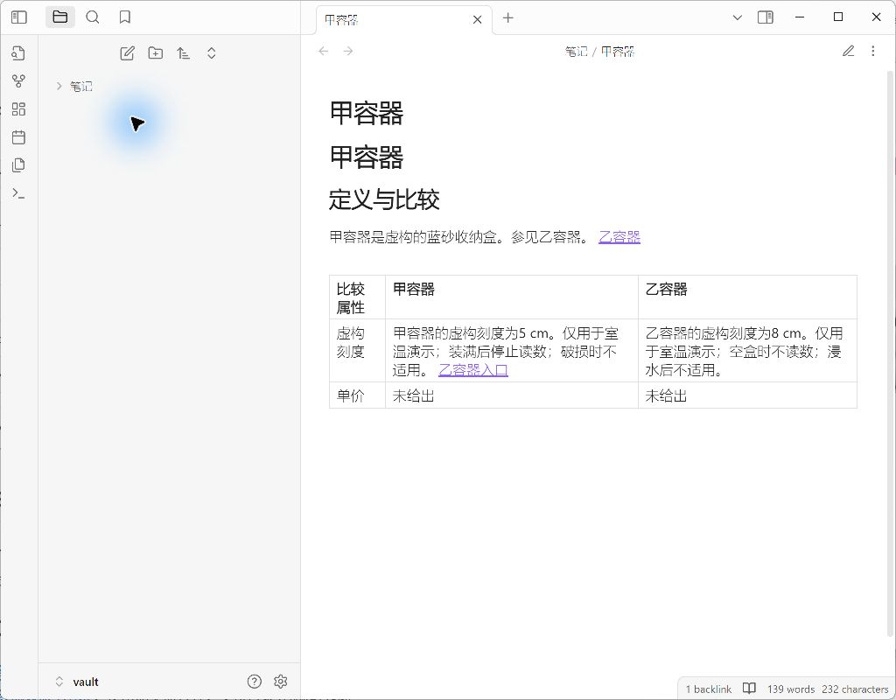
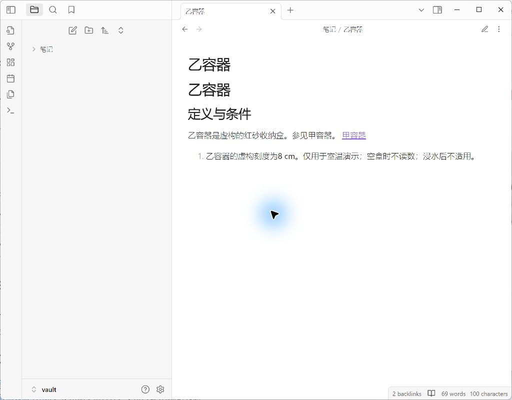
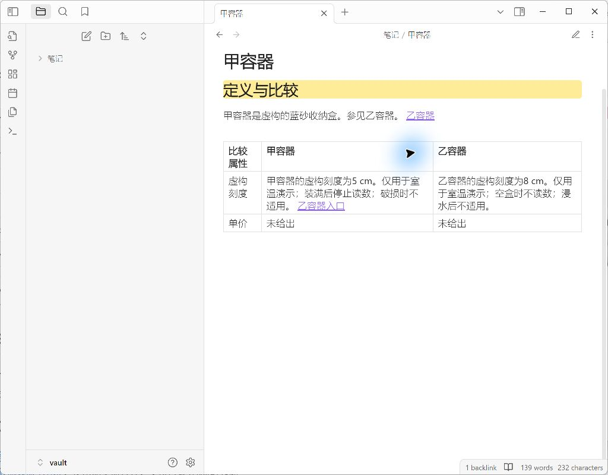

# B02-T03 Fixture 到全新临时 Vault 验收

2026年11月1日，本机Windows x64。本任务实现`case compile <case-root> <new-output-root>`：使用明确自造、producer=fixture的已审阅IR、计划和独立expected，生成两份关联笔记与比较表，重读实际输出，保存本轮Run/Coverage/Release及JSON/Markdown验证报告。执行方案见[B02-T03方案](../execution/B02-T03_PLAN.md)，实际运行、指纹和原生截图索引见[JSON证据](B02-T03-local.json)。不把fixture通过称为PDF解析、模型抽取或科学质量通过。

## 结果与产物

两份自造来源有12个完整Span、4个必要原子、5处支持证据。正常编译生成`笔记/甲容器.md`、`笔记/乙容器.md`，含两个定义、5 cm/8 cm的条件与例外、三列比较表、明确“未给出”的单价，以及两个规范章节链接。计划和expected来自作者声明，程序没有自动规划表格或抽取知识。

| 验收项 | 实际结果 |
| --- | --- |
| 全新输出根与人工内容保护 | 既有目录/文件、已编辑笔记、输入输出双向重叠、不安全Windows路径和junction被拒绝；实际输入/expected/外部哨兵不变 |
| 来源与必要知识 | sources/coverage/knowledge/note_plan/expected全部通过才创建运行；缺条件、缺原子、pending覆盖、旧IR绑定及断链均不能发布 |
| 有限Markdown编译 | 两份作者固定的完整字面输出一致；表格别名变体另在计划和独立expected中预先声明，实际输出为转义竖线wiki链接 |
| 实际输出验证 | 重读暂存和Vault；独立解析结构/正文/完整scope/全部链接；9条内容映射含5知识scope及4标签/未给出scope |
| 状态与双报告 | JSON、Markdown分别解析并对齐状态、理由、计数、问题、文件修订、完整内容/链接scope与SHA；科学质量not_run，研究not_applicable |
| 发布依据 | SQLite最后单事务绑定真实文件清单和两报告SHA，并同步Run.succeeded、Release.published、12条Coverage.validated；验证快照validated不提前代表发布 |
| 两次执行 | 同fixture两新目录内容字节、Concept/Atom/Note/Section引用身份一致；Run/Release UUID和调用时间独立 |
| 故障与中断 | 实际单位丢失、首份暂存失败、未知内容、报告占用、真实COMMIT Busy、暂存后kill和真实热日志均无错误published；残留可定位 |
| 提交后输出失败 | 普通CLI真实关闭stdout管道，退出1/CLI_OUTPUT_ERROR，已提交Run/Release/Coverage及publication commit仍正确 |
| 干净Obsidian | 隔离配置的1.6.7阅读模式实测标题、列表、表格、中文路径及三条标题链接；无社区插件 |

新根下`state/compile.sqlite`为独立编译Schema1（application_id=0x4e434d50），与来源项目Schema2分开。固定六表为compile_metadata/runs/releases/coverage_records/rendered_files/publication_commits。Vault仅含笔记，状态、候选及报告在相邻目录；不存在的预检产物不被当作已生成报告。

成功stdout外层release_status为published，退出0。语义预检失败输出not_started、output_created=false及稳定问题，退出3；未知字段/版本、非法UTF8 JSON或不安全路径在报告前退出2。既有目标/重叠及实际I/O阻断退出3。拥有根后的失败输出staged或recovery_required，stderr为CASE_COMPILATION_FAILED。报告是不可变验证快照，已写validation.*后的后续错误另存failure.*；完整报告或失败登记无法完成时，只有归属仍可确认的目录才允许独占写恢复诊断。

## 真实故障与审查修复

先用旧CLI运行正常compile期待退出0，实得2/CLI_INVALID_ARGUMENT；渲染、存储和报告使用可编译stub先获得行为断言红灯，再实现。编译/setup错误未作为产品红灯。初次CLI为5通过/7失败，其中映射数量被测试错误限定为5、误读旧verify的passed字段，已按真实compile契约修正；原fixture/expected未因此改写。

Windows verbatim PathBuf::join会预先归一`..`，最初的负例实际传入的是安全路径，不能算产品越界。改用原始OsString保存真实`\..\`参数后，7个路径负例均零创建拒绝。同根/祖先重叠错误优先级确有红灯，调整为COMPILE_INPUT_OUTPUT_OVERLAP后通过。独立脚本首次误将既有目标期待为退出2，实际规范为阻断3；保留旧自有测试现场，修正调用预期后在新根完整重跑。

存储模块真实复现不相关Markdown可被误接受、错误基础计数可建库；增加typed报告/实际Markdown匹配与LoadedCase计数检查后红转绿。独立复审又发现实际暂存内容校验失败仍登记staged，以及Markdown漏plan_revision/完整link scope。分别增加真实状态断言及只改元数据的独立harness，复现后修正为recovery_required和完整字段呈现。报告字面下划线也先真红，再补Markdown转义；解析器按标准ASCII标点解码。最终复审这些差异均已改变Markdown，无残留阻碍。

实际单位故障从渲染字节中删掉`cm`，重新计算SHA/长度并更新后续范围。output_manifest仍passed，output_content与staging_output为failed，stdout和SQLite Release均为recovery_required，publication_commits为0；别名不能补足正文条件。首份暂存callback失败留Run.failed/Release.staged及实际双报告，Vault基础目录为空。

暂存中断由测试构建的专用入口调用同一编译核心，持久两文件清单后写握手并等待stdin。父进程确认其存活，实际kill/wait，重读Run.running/stage=staged、Release.staged、2条文件记录、0 publication commit，无Vault笔记或报告，原根重试被拒绝。普通产品CLI不暴露故障参数或环境开关。

真正的SQLite SHARED读锁阻止最后COMMIT，验证显式rollback/autocommit后publication为0、Coverage未validated、Release保留verified；因同一锁使失败登记也无法提交，recovery.json保存待恢复原因。另一个真实子进程进行2 MiB主文件溢写，确认存活后kill，产生热journal；只读核对明确拒绝并保持数据库与journal字节。受控测试不能证明任意断电自动恢复。测试完成后回收经归属检查的自有沙盒，产品编译器本身不自动清理残留或接管旧根。

## 最终实际检查

```powershell
cargo fmt --all --check
./scripts/cargo_local.ps1 check --workspace --locked --offline
./scripts/cargo_local.ps1 test --workspace --locked --offline
./scripts/cargo_local.ps1 build -p noetome-cli --locked --offline
npm run web:build
python -m unittest discover -s tests -p 'test_*.py'
python fixtures/text-compare-v1/audit_fixture.py
python -m py_compile scripts/verify_fixture_compile.py
python scripts/devlog.py check
git diff --check
```

选定工作区Python为3.12.14，按本轮返回的绝对解释器路径执行，未写死到仓库。Rust工作区**247通过、0失败、0忽略**：CLI库164、既有CLI进程4、compile进程12、fixture进程20、项目13、来源19、桌面15。库内新增渲染17、存储21、协调故障8、报告4。两个测试子进程入口在无环境时正常返回，父测试仍实际启动它们完成kill场景。compile的12组包含35次普通CLI调用。格式、离线locked check/build、TypeScript与Vite生产构建通过；Python日志工具12项通过，作者审计再次通过，expected SHA保持`0477e6dc10ee3e5be654a3bbce4c22cb214972bf658a58e9f8a0cf16db39eadd`。

## 最终副本与复现

最终普通CLI副本为`D:/Noetome/.artifacts/compile-cli-final-20261101/noetome.exe`，SHA为`c08393bed4cca09493e3df1b089a81864da08a1f94c46bfb340bec03becb4d25`，只读查询的Medium RID=8192。prepare脚本只复制、核对指纹和标签，没有安装或改ACL。副本与最终独立构建SHA一致；原target树Low与普通目录验收上下文分开记录。

在全新`.artifacts/compile-smoke-20261101-final`执行[独立标准库检查脚本](../../scripts/verify_fixture_compile.py)，**8次调用符合预期**：两次正常发布、拒绝既有根、拒绝输入输出同根、拒绝缺失父目录、条件遗漏、pending覆盖，以及预先声明的表格别名变体。三次发布均独立重读笔记、实际范围/条件/单位/链接、四维与计数、四包指纹、全部12条覆盖及publication commit的双报告/清单SHA。原fixture、expected和外部哨兵保持不变。正常甲/乙文件SHA分别为`33eedf491e2ab58e5ee7d2da80c701e91bb0c77700b0212672a1ddbed2bfa376`、`349f06a40ea199f4d2fb2f6ebcecf61aa652a571ea18e1e81f665a11cf505b88`。

```powershell
./scripts/cargo_local.ps1 build -p noetome-cli --locked --offline
python scripts/verify_fixture_compile.py --cli '<实际可读CLI副本>' --root '<父目录已存在的全新测试根>'
```

## Obsidian 实机有限语法

安装器/运行应用版本为1.6.7.0/1.6.7。使用独立`--user-data-dir`配置和仅复制本轮生成笔记的新测试Vault，无社区插件；没有打开生产笔记。原生测试用表格别名变体，笔记字节与最终发布变体一致。界面实际显示三列、两行比较与未给出值，表内别名没有拆列；点击表内“乙容器入口”和正文“乙容器”均定位乙的“定义与条件”，点击乙正文“甲容器”返回甲的“定义与比较”，有序列表及5 cm/8 cm条件/例外完整显示。







第一次隔离配置在starter打开后自动下载更新，未出现可用测试库窗口，记为setup失败；重建自己的隔离配置、关闭该测试配置的自动更新并使用有效固定Vault标识后，既有1.6.7成功打开。本次未把下载后的1.14.5或当前稳定版矩阵算作通过。官方[内部链接规则](https://github.com/obsidianmd/obsidian-help/blob/master/en/Linking%20notes%20and%20files/Internal%20links.md)和[表格转义规则](https://github.com/obsidianmd/obsidian-help/blob/master/en/Editing%20and%20formatting/Advanced%20formatting%20syntax.md)用于确定语法，实际界面验收另如上记录。

没有运行MathJax、Mermaid、SVG、Properties或块链接；没有跨平台/全部Obsidian版本支持结论。当前稳定和最低支持版本的完整矩阵、真实PDF/API知识质量、生产Vault增量合并及任意断电恢复继续属于后续门槛。桌面安装版的托盘/关闭设置保持先前验收版本，未接入这轮fixture业务。B02闭环满足本批有限验收，下一批按真实结果展开B03文本PDF任务。
