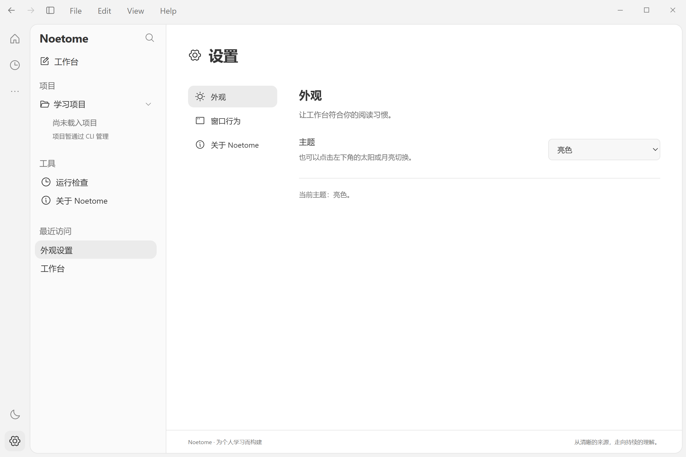
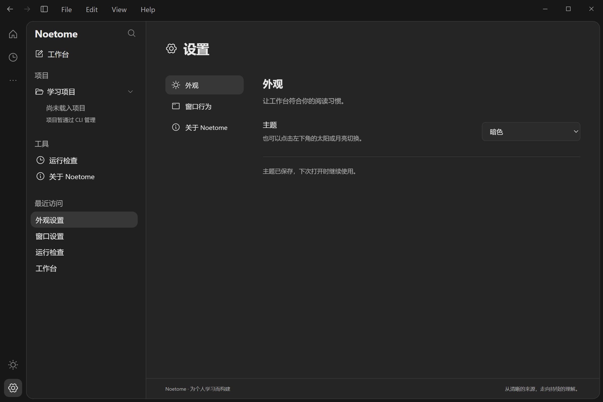

# B05U-T01 侧栏、分类设置与默认 main 验收

用户要求按两张 Codex 截图调整侧边栏与设置，明确选择设置上方的太阳/月亮直接切换亮暗，并授权创建 main、合并与设为远端默认。附件只作为视觉参考，截图内的聊天与输入框文字不扩展本项权限。

基线为已验收 B05-T02 的 `eb674f1`；任务分支为 `codex/b05u-t01-sidebar-settings`。当前前端源码与安装包验证基于 `012fd8b842c2b351f8ec3ae969eb11714e74abb0`。Rust、Python、已有 fixture 和 CLI 源码相对基线没有改变，文件指纹见[源码清单](assets/B05U-T01/source-fingerprints.json)。

## 实际实现

- 52px 固定图标栏与 238px 分组侧栏；使用中性灰白/暗色、细边框、圆角选中态、独立滚动。项目显示真实空状态，最近访问来自已访问页面。
- 独立设置分为外观、窗口行为、关于 Noetome；宽屏左侧分类、右侧字段，窄屏分类换行。窗口关闭偏好继续调用已有 Rust 读取/保存接口。
- 设置上方月亮将亮色切到暗色，太阳将暗色切回亮色；与设置页主题选择共享状态。实际使用 `noetome.appearance.theme` 本地存储，保存成功后才生效，读取/写入/非法值失败有明确反馈。
- 原顶部单行菜单、前进/后退、侧栏隐藏、键盘导航、帮助/版本及运行检查保留。搜索使用全部现有页面；360px 侧栏默认收起，导航后收起并聚焦可见主内容。
- 使用锁定的 Phosphor 2.1.10 图标并保留 MIT 许可。学习项目业务仍按既有 CLI 管理，本项没有新增假项目或聊天。

## 浏览器与视觉证据

旧界面缺少图标栏、项目分组、独立设置和主题入口的实际 RED 见[原始记录](assets/B05U-T01/browser-red.json)与[旧界面截图](assets/B05U-T01-before.png)。

实际 IAB 记录共有 28 条历史检查，包含行为 RED、工具/选择器失败及恢复。最终选用 19 条有效通过记录，[门禁](assets/B05U-T01/browser-gate.json)逐条列出原历史索引；没有将历史全部称为通过。浏览器警告/错误为 0，原控制台见[完整记录](assets/B05U-T01/browser-console.json)。

| 实测内容 | 结果与证据 |
| --- | --- |
| 设置入口、分类与历史 | 外观默认打开；分类进入前进/后退；隐藏侧栏释放 238px 且底部按钮保留 |
| 搜索、项目分组与键盘 | 全部设置可搜索、无匹配反馈、Escape 恢复焦点、Enter/Space 展开收起项目、顶部菜单键盘导航通过 |
| 月亮/太阳与持久化 | 实际亮暗切换、主题选择同步、重新载入后保持选择 |
| 存储错误 | 单页受控 fixture 使用真实应用入口，覆盖写入拒绝、读取拒绝、非法值与恢复；写入失败保留亮色且不显示成功。测试结束返回正常根页面，没有产品故障开关 |
| 1200px | 实际栏宽 52/238px、项目标题 top 140px、主题位于设置上方、无横向溢出 |
| 640 × 600 | 长内容 scrollTop 69.5，scrollHeight 983 / clientHeight 512，底部设置固定 bottom 590 |
| 360 × 600 | 侧栏默认收起，显式打开后从设置/搜索/历史导航收起；字段最右 329px，Tab 焦点可见 |
| 图标对比度 | 亮色未选中 3.28，暗色未选中 5.33；旧 2.77 发现已修正 |

审查发现“未访问的窗口设置不可搜索”和“窄侧栏覆盖导航后的焦点”。[实际 RED](assets/B05U-T01/review-red.json)先复现两项，再由 `012fd8b` 修复，最终历史索引 18/20 为 GREEN。首次复测服务仍返回旧 App 变换；停止本次拥有的旧 Vite、重启后核对实际服务源码，再取得有效 GREEN，旧失败保留。原生源码复查未再发现 actionable Critical/Important/Minor，[审查记录](assets/B05U-T01/review.json)说明范围。

完整参考图经密度归一化后与全高实现侧栏并排，已经实际打开检查。首行/分组留白与图标对比度修正后无必要视觉问题；包含用户其他项目标题的参考和并排图只保留本地。最终[视觉验收](../../design-qa.md)为 passed。

窄布局：[360px](assets/B05U-T01-browser-360.png)、[640px](assets/B05U-T01-browser-640.png)。浏览器原截图返回 JPEG 字节后转换成独立 PNG；安装版截图为原始 PNG，1200 × 800 CSS px / DPR 2，实际图像 2400 × 1600。[截图尺寸与指纹](assets/B05U-T01/screenshots.json)保留格式和来源说明。

## 实际构建、回归和安装版

| 检查 | 实际结果 |
| --- | --- |
| `cargo fmt --all --check` | 退出 0，[报告](assets/B05U-T01/fmt.json) |
| `cargo check --workspace --locked --offline` | 退出 0，[报告](assets/B05U-T01/cargo-check.json) |
| `cargo test --workspace --locked --offline -- --test-threads=4` | 17 组、591 通过、0 失败、0 忽略；107.672s，[报告](assets/B05U-T01/rust-tests-verified.json)、[完整 stdout](assets/B05U-T01/rust-tests-verified-stdout.txt) |
| `python -m unittest discover -s tests -p "test_*.py"` | 157 通过，实际测试 98.900s；进程退出 0，[报告](assets/B05U-T01/python-tests-final.json)、[结果](assets/B05U-T01/python-tests-final-stderr.txt) |
| TypeScript 与 Vite | 复查修复后 `web:check` 退出 0，最终 desktop build 内再执行 `web:build` 含 TypeScript 检查，60 modules；[检查](assets/B05U-T01/web-check-review-fixes.json)、[最终构建](assets/B05U-T01/desktop-build-final-source.json) |
| NSIS 安装 | 退出 0，当前用户安装目录、开始菜单/桌面快捷方式与卸载登记相符；实际安装文件完整 SHA 与当前构建的精确 Tauri NSIS 标记变体相符，[包核对](assets/B05U-T01/installer-payload.json) |
| 安装后 WebView | 7 项实际 UI/IPC 检查通过，两个进程控制台错误 0；[首次](assets/B05U-T01/native-first.json)、[重启](assets/B05U-T01/native-restart.json)、[监督进程](assets/B05U-T01/native-supervisor.json) |
| 日志与差异 | 集成前 devlog 19 项检查通过，`git diff --check` 退出 0；[日志](assets/B05U-T01/devlog-before-integration.json)、[差异](assets/B05U-T01/diff-before-integration.json)；完成及切批次后另检查 |

Python 使用已存在的 Python 3.12 精确 PDF 锁定环境；Rust 的 PDF 解析使用该解释器，受控 fake sidecar 使用工作区 Python，编译临时目录使用已核对的普通 `target/compiler-temp`。原始报告保留实际绝对解释器、argv、选择环境、时长、退出码及输出 SHA；仓库产品配置不写死本机运行时路径。

最初基础运行时的 Pillow/pycparser 与 PDF 锁不符，Python 出现 37 个失败；Rust 初次缺少所选解释器、随后测试临时目录/受控 sidecar 时限失败。没有修改业务代码或放宽门槛；确认已存在精确依赖环境和编译临时目录后完整通过。首次工具输出有截断，保留于[初次输出](assets/B05U-T01/initial-test-failures.json)，后续失败与最终完整 stdout/stderr 均独立归档，不用截断输出宣称全量结果。新临时 venv 依赖安装挂起后停止该自有安装进程，最终复用已核对环境。

最初桌面构建进程实际退出 0，捕获工具因 GBK 输出失败；将捕获 stdout/stderr 设为 UTF-8 后重新运行，最终源码构建正常退出 0。首次安装调用系统 Windows PowerShell 缺少 `Get-FileHash`，在启动安装器前退出 1；改用工作区 PowerShell 后同一已有安装脚本正常安装，失败和恢复[报告](assets/B05U-T01/desktop-install.json) / [最终报告](assets/B05U-T01/desktop-install-verified.json)均保留。

Windows 原生输入工具本轮无法可靠触发控件：AX 点击报输入几何不可用，坐标/按键未导航。故安装验收通过仅自有测试进程的 `127.0.0.1` WebView 诊断口操作实际安装页面；没有 mock Rust 或替换组件。实际取得 Tauri invoke、CLI/桌面 0.1.0、真实帮助/版本和连接成功，实际保存/重读关闭偏好，再按“直接退出”点击关闭并确认首个进程退出 0。第二个真实新进程读取到暗色及退出偏好，恢复原亮色/隐藏到托盘并重读/载入确认。诊断实例清理退出码 1 是测试主动结束自有进程，不作为窗口关闭验收；随后普通无诊断参数启动安装应用并保持打开。

最终安装 exe SHA256 为 `c54f17f014c31d1c435896936e7a538d7d625d206c41d510a7c1bb62615c1fe0`；安装包 SHA256 为 `92f7dc7824b3c4eb007b3c69db7d484563d0556a0807c776868293ade62bc0e3`。安装前后明确选定的模型配置、用量和 DPAPI 文件仅读取指纹，字节/mtime 均不变；窗口偏好通过真实保存后恢复到原字节 SHA，见[保护结果](assets/B05U-T01/settings-protection.json)。没有解密凭据、调用模型或写用户生产 Vault。

## main 集成与日志收束

UI 实现、必要修复、实际浏览器/安装版和回归已完成；本记录提交时 main 集成仍待实际创建、推送和远端默认核对。任务保持 in_progress，待远端事实完成后追加真实证明并通过日志工具 complete，不以 UI 完成代替分支要求。

用户已有的 `docs/Noetome-PRD-v1.0.md` 和 `.html` 未提交删除保留，未被本项暂存。原 B05-T03 的 ID、依赖、验收与历史保留在 B05R；本项结束只恢复执行入口，不启动下一任务。

[原始归档映射](assets/B05U-T01/archive-map.json)核对每份复制内容的 SHA；原始输出自身的尾部空行/空白保留，沿用仓库的专用 evidence attributes 防止 Git 换行改写字节。产品源码及 Markdown 仍执行通常的差异检查。[验收聚合](assets/B05U-T01/gate.json)引用实际检查。记录不宣称 Windows 实体指针/拖动、托盘全矩阵、真实模型科学质量或完整知识编译已在本项验收。
