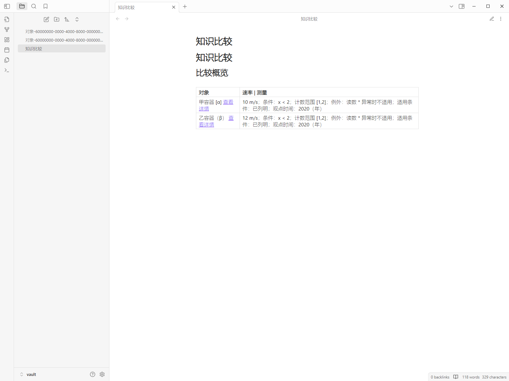
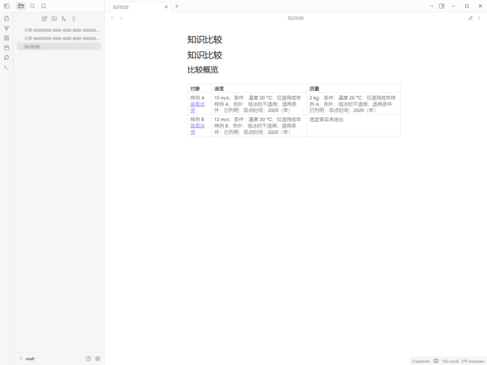
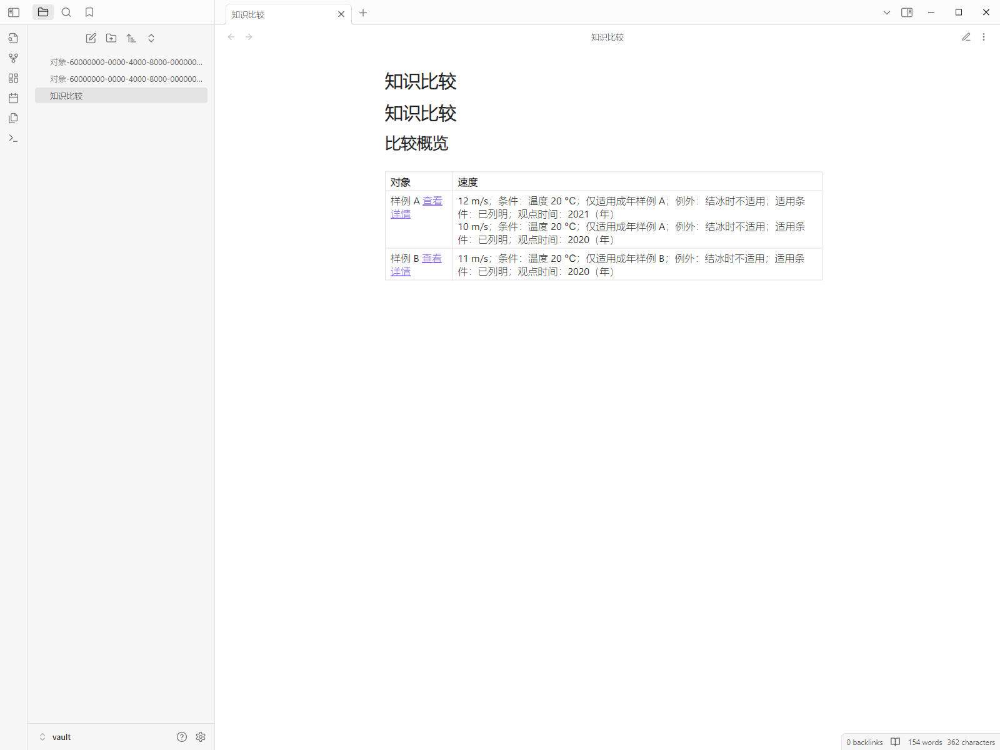
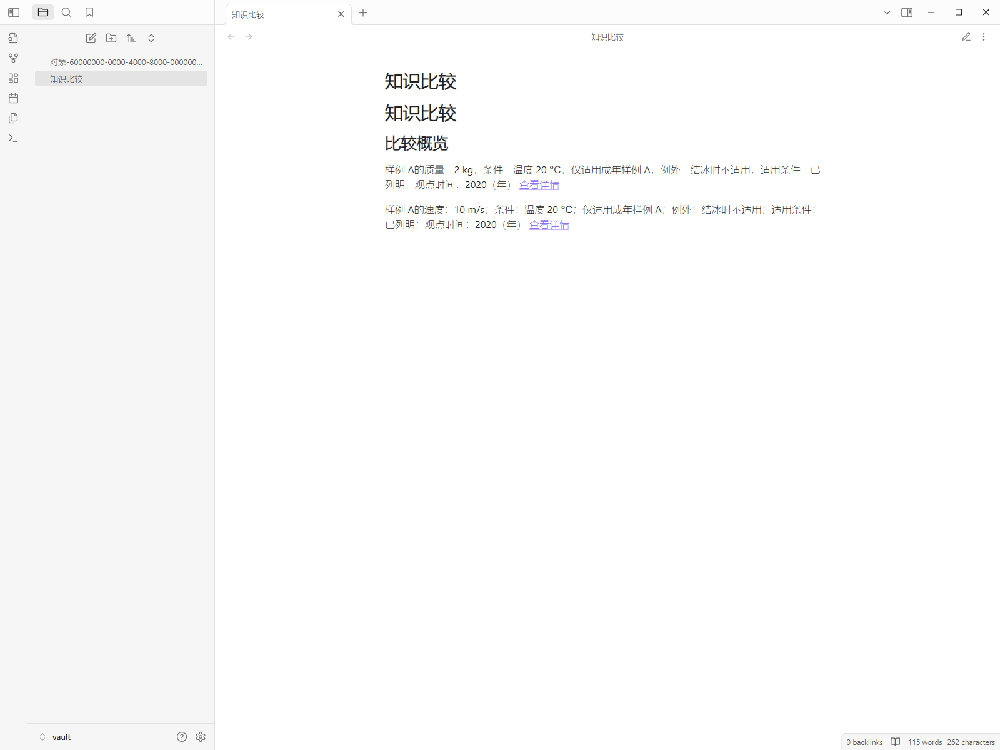
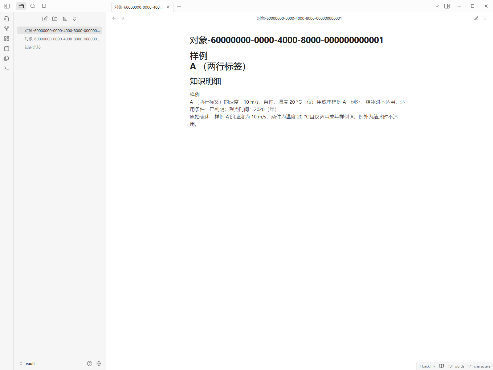

# B06-T01 原生 Obsidian 表达验收

本目录保存 2026-11-05 的真实安装版 Obsidian **1.6.7** 验收：Electron 30.1.2、Chromium 124.0.6367.243。每个场景使用新的 `--user-data-dir` 和新的测试 Vault，关闭该隔离配置的更新，社区插件清单为空。只复制普通 CLI 生成的 Markdown 原字节，没有打开生产 Vault，也没有把配置写进原审计输出。

[summary.json](summary.json)记录 **13 个场景、38 份笔记、26 次真实链接点击**。12 个场景来自已完成独立重建/篡改审计的 Linux CLI 输出；另一个是审查发现的合法多行/Tab 对象名回归，先保存原失败与修复后的普通 CLI 输出，再按独立固定标签预期实测。

实际读取 Obsidian 的预览 DOM，逐份核对标题、逐格表格、段落与内部链接；实际点击概览中的每条链接，并确认中文目标路径和“知识明细”标题。覆盖普通比较、稀疏缺失、单对象正文、无共同属性正文、明确不适用、多条件组、历史组、特殊字符、不同原单位、旧版 v1/v2 和跨事实角色复用。多行标题额外核对真实 `<br>` 和 DOM 中原始 Tab U+0009。截图由连接到原生应用的 CDP 页面获取；不是用浏览器重新实现 Markdown 渲染。

两个协调阻断样例没有成功计划和笔记，因此没有被送入 Obsidian 冒充成功。所有结果仍是 `knowledge=pending`、`science=not_run`、`published=false`。此次仅证明已记录版本的有界表达与导航；完整 Obsidian 版本矩阵、科学正确率、流程图和公式不在本验收范围内。

## 原件与重放

- [originals.zip](originals.zip)：410 个原件，包含逐场景实际 DOM、截图、复制笔记、计划/报告/预期、启动与清理记录、干净配置及失败历史。`replay-harness/` 保存最终重放脚本；早期标准场景在后来增加多行标题专用 DOM 字段前执行。
- [archive.json](archive.json)：ZIP 与每个成员的 SHA-256 和字节长度，归档后已逐成员重新读取核对。
- [capture_obsidian.mjs](capture_obsidian.mjs)：真实原生 CDP 渲染/点击脚本；精确确认本次 profile/Vault 后才允许退出该实例。
- [run_capture.py](run_capture.py)：接收显式运行时路径的 WSL 启动/保护脚本。原生 Python 分配端口；等待 Obsidian 文件索引和 workspace layout 就绪后捕获。检查原审计目录和复制笔记前后字节，并读回具体 PID 与端口均已退出。
- [multiline-render-expected.json](multiline-render-expected.json)：在多行标题实机捕获前固定的独立标签预期，来自已保存的审查 RED 标签，不从渲染结果反推。

重放时为每次运行提供未存在的 `new_work`，并传入本机实际安装路径；不要覆盖已归档的失败或成功目录。示意命令中的参数均需由本机实际环境提供：

```text
python run_capture.py <audit-root> <case-name> <new-work> <obsidian-exe> <powershell-exe> <native-python-exe> <playwright-core-index.mjs>
```

首次启动遇到 WSL 端口无法在 Windows 绑定、文件索引尚未完成、workspace layout 尚未完成；均发生于实际渲染检查前，原失败已保留，随后新根通过。`two_objects` 首次复制前被审计目录中故意保留的链接哨兵触发；改为仅记录链接文字而不跟随后，新根通过。没有把这些尝试计入 13 个成功场景。

[final-source-linkage.json](final-source-linkage.json)保存后续实际完成的最终版本关联：稳定源码 `452dc557c439332aba8c0ae4e27aa7b9768c5f03` 的原生 Windows 五项回归全部通过后，重新核对完整源码快照、最终 CLI 指纹和第二轮测试日志，再比较其新生成的 **13 个场景、38 份 Markdown**，全部与上述真实 Obsidian 捕获笔记逐字节一致。多行标签从本轮实际测试日志定位测试目录，并按完整标题唯一匹配。[link_final_source.py](link_final_source.py)保存此只读对照方法；这项关联没有新增渲染或扩大版本兼容结论。

## 代表截图











