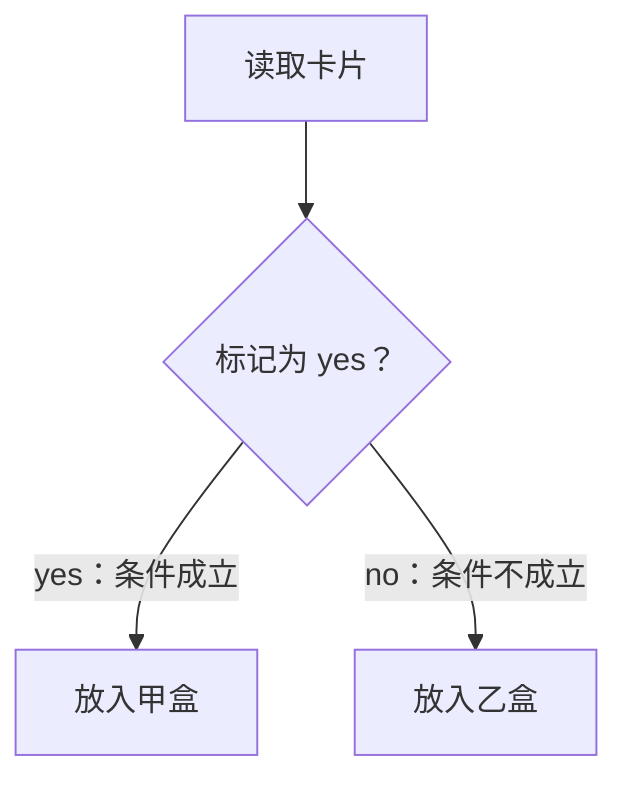
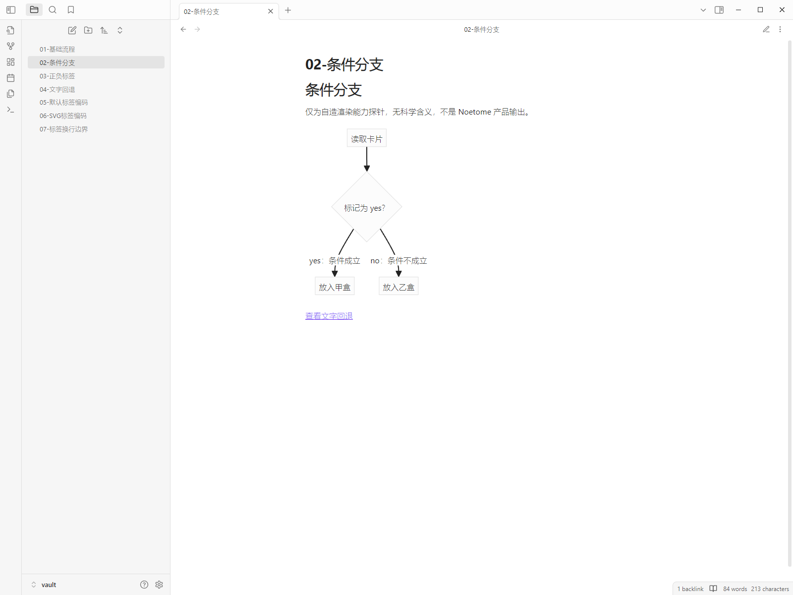
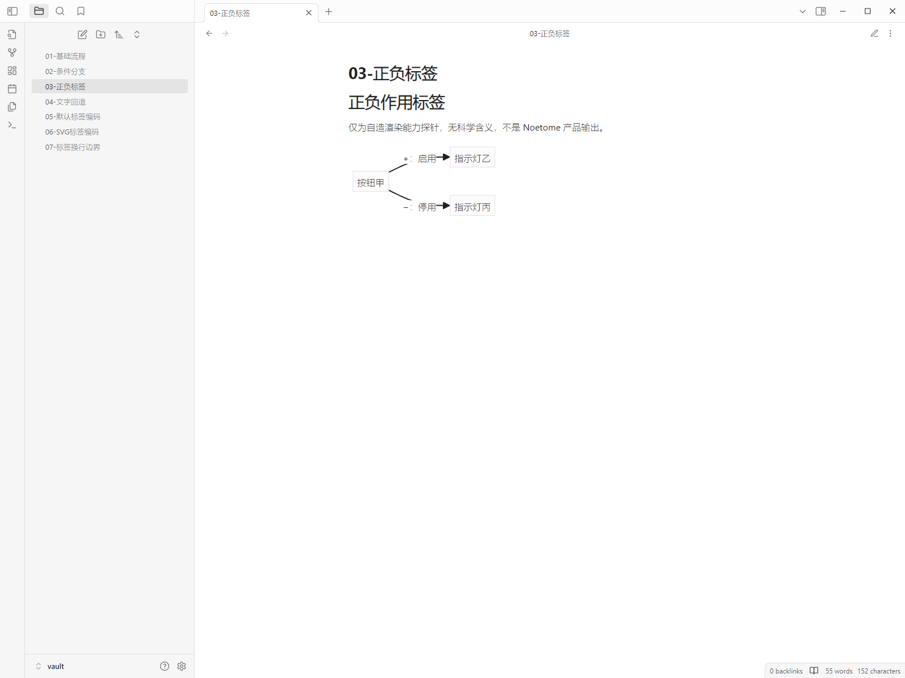
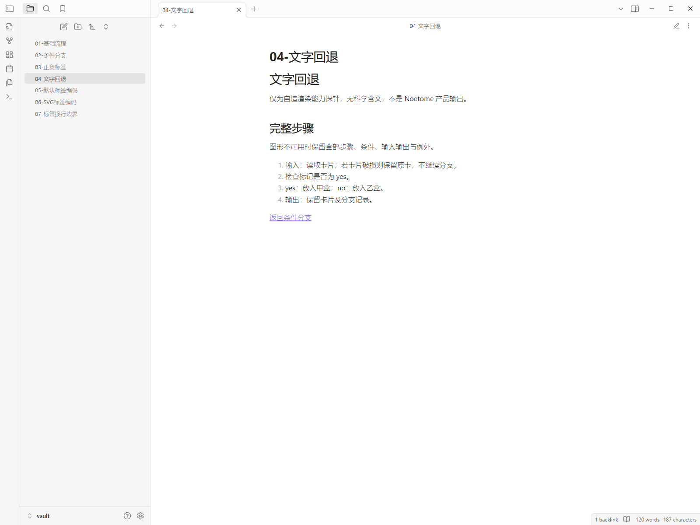
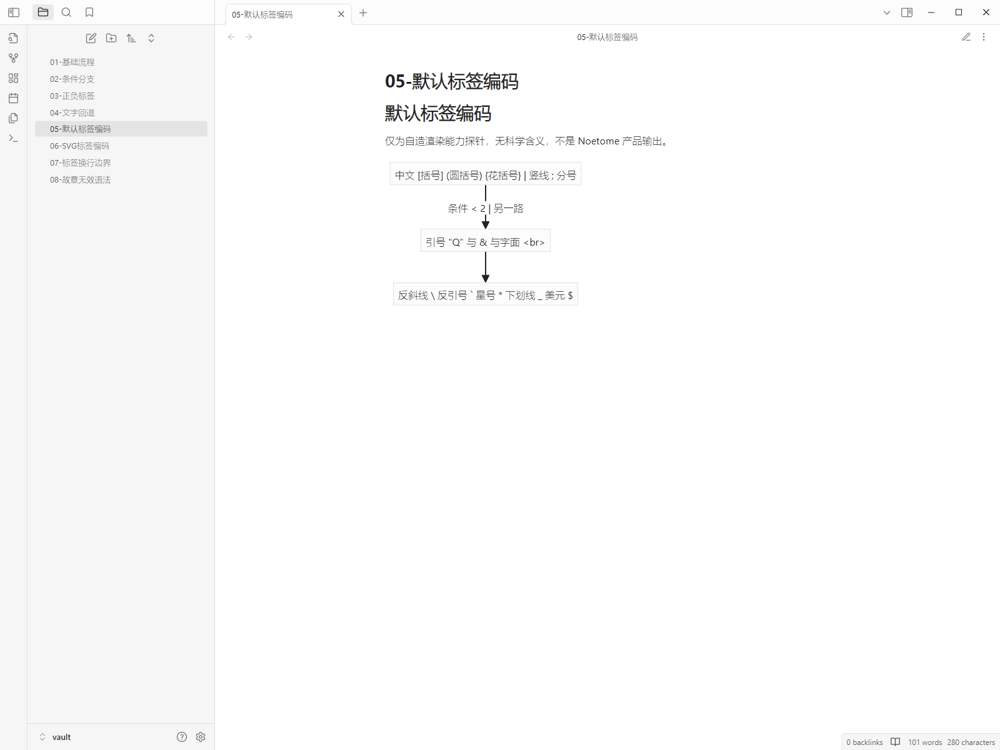
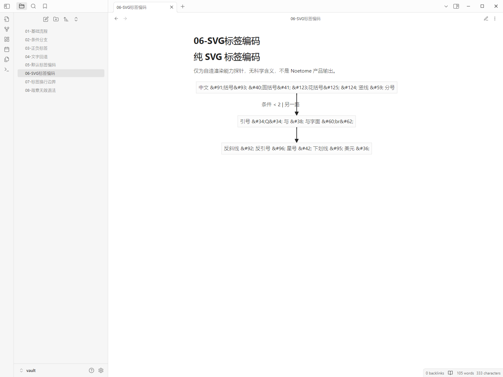
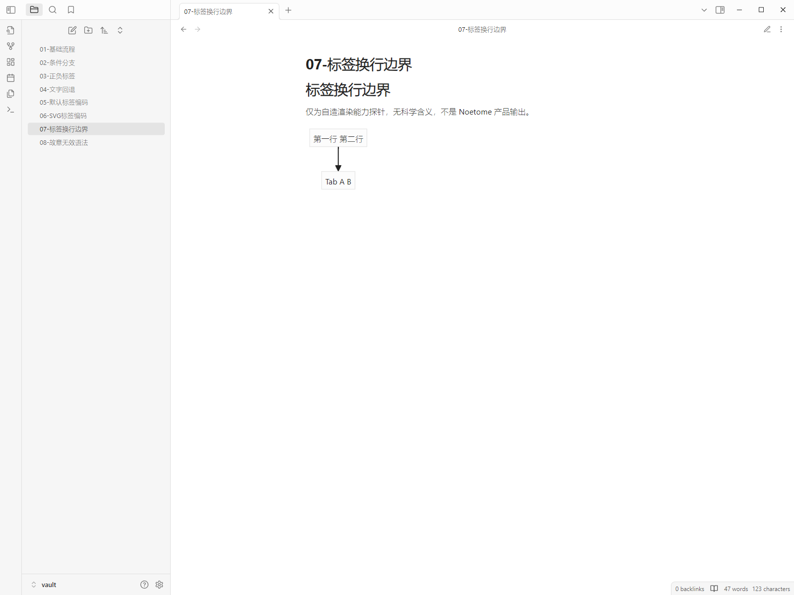
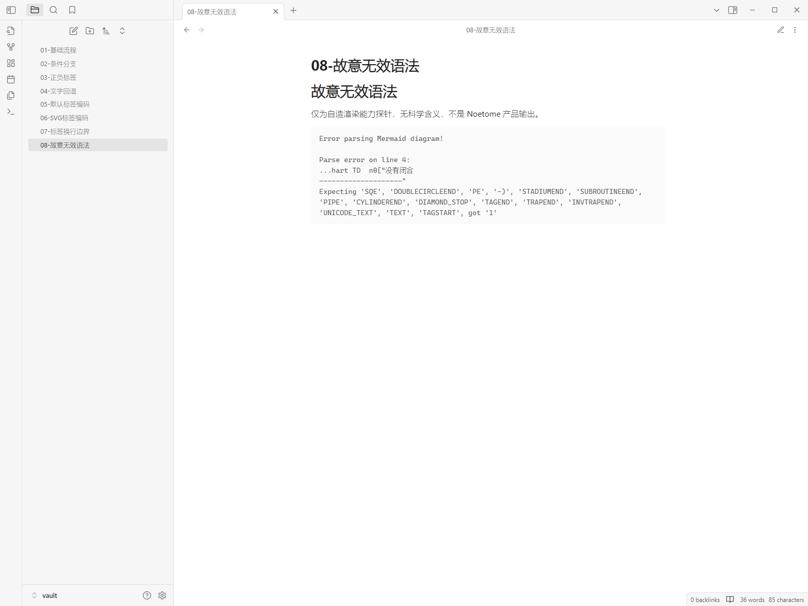

# Obsidian Mermaid 有限能力探针

这是 **B06-T02 开始前后的技术能力调查，不是 Noetome 流程图产品验收**。输入是人工自造、无科学含义的卡片/按钮 Markdown；没有运行来源核对、协调或流程规划产品链。不得把本探针的手写图计为“主动生成流程图”或语义正确率。

2026-11-05 在新建测试目录、独立 `--user-data-dir`、无社区插件的实际 **Obsidian 1.6.7** 中运行。实际 Electron 为 30.1.2，Chromium 为 124.0.6367.243；本机安装包内 Mermaid 为 **10.6.1**。运行时全局不公开 `.version`，版本来自同一安装目录 `obsidian.asar` 的 Mermaid 源文件头部和内部常量，成员指纹与 ASAR 自带完整性值一致，见[bundled-mermaid.json](bundled-mermaid.json)。没有用远程最新版本代替本机事实。

实际读取的配置为 `securityLevel=strict`、`flowchart.htmlLabels=true`、`defaultRenderer=dagre-wrapper`。全部来源测试 Markdown 在打开前固定指纹，运行后原字节不变；三个尝试的自有 PID 和端口均确认退出。

## 已观察能力与边界

| 输入 | 实际结果 |
| --- | --- |
| `flowchart TD` 三节点顺序 | 三节点、两条有终点箭头的边；端点身份及向下几何方向匹配 |
| 矩形加菱形条件分支 | 四节点、三边，`yes：条件成立` / `no：条件不成立` 完整显示 |
| `flowchart LR` 正负标签 | `+：启用` 与 Unicode `−：停用` 原样显示，两边向右且目标正确 |
| 普通有序文字回退 | 四步、输入输出、条件、例外完整；与图笔记的中文标题链接双向实际点击成功 |
| 默认 HTML 标签，双引号包裹、ASCII 标点十进制实体编码 | 本次引号、各种括号、竖线、分号、`&`、字面 `<br>`、反斜线、反引号、星号、下划线、美元均保持相同可见文本；边标签的 `<` 与竖线也保持 |
| 同一编码加 `htmlLabels=false` | **不兼容**：显示 `&#91;`、`&#34;` 等实体文字，不能沿用同一编码直接切换 |
| 默认标签的 `#10;` / `#9;` | DOM 保留换行/Tab，但 `white-space: nowrap` 将可见文字折叠为空格；**不证明换行保真** |
| 未闭合引号的 Mermaid | 实际显示解析错误，无成功 SVG；不能算成功表示 |

[summary.json](summary.json)包含逐项结论、实际方向端点、配置、导航及清理记录。探针原始 `nodesMatch` 会归一化空白，因此不能单独作为标签完整性门槛；补充记录的 `visibleText` / `visualWhitespacePreserved` 和原始 DOM、截图揭示了换行折叠。

## 给本轮编译器的有限建议

这些建议只针对已经观察到的环境，产品仍需自己的来源/关系验证与最终实机检查。

1. 先使用生成的 ASCII 节点 ID（如 `n0`、`n1`），固定 `flowchart TD`，矩形节点及必要菱形分支。方向由已核对关系决定，不能根据视觉顺序反推关系。
2. 节点和边标签均放入双引号结构；将标签内 ASCII 标点编码为 Mermaid 的 `#N;`，其中 `N` 为字符十进制码点。例如引号为 `#34;`、竖线为 `#124;`。本探针只证实列明的有限单行标签，后续仍要独立核对实际标签。
3. 保留已测默认 HTML 标签路径；不要因“纯 SVG”看似简单就切换到 `htmlLabels=false`。如果渲染配置不匹配已测 profile，使用明确的文字回退并保存原因。
4. 含换行/Tab 或尚未可靠验证的标签先回退为保留原文的有序文字；不能静默压平空白。若以后新增换行编译规则，须另行核对字面 `<br>` 与结构换行的区别。
5. 编译器只发出固定结构语法，不拼接作者提供的 `init`、`click`、class/style、URL 或其他指令。普通正文链接承担导航，本次没有验收图内 `click` 功能。
6. `+` / `−` 标签只负责显示已经核对的正负作用，箭头能渲染不证明因果正确。未决语义需要阻断；单纯渲染不兼容才适用有据文字回退。

本次实际通过的最小形状示例：



## 原件与重放

- [originals.zip](originals.zip)：141 个原件，包含手写探针、打开前指纹、实际 DOM/SVG/截图、干净配置、启动/清理、第一次失败和可重放脚本副本。
- [archive.json](archive.json)：ZIP 与全部成员的 SHA-256 和字节长度；归档后已逐成员重读核对。
- [launch_probe.py](launch_probe.py)、[probe_capture.mjs](probe_capture.mjs)：使用显式本机路径，创建全新 profile/Vault；实际连接安装版 Obsidian，读取 DOM 并点击普通链接。`--focused-boundaries` 只捕获后续标签/语法边界。
- [inspect_bundle.py](inspect_bundle.py)：只读本机 ASAR，校验 Mermaid 成员字节并保存版本依据。

示意重放命令：

```text
python launch_probe.py <new-work> <native-python> <installed-Obsidian.exe> <powershell.exe> <playwright-core-index.mjs>
python inspect_bundle.py <installed-resources/obsidian.asar> <new-metadata.json>
```

首次尝试已捕获七份笔记，但随后 `require('obsidian')` 在非插件模块上下文失败，未完成元数据和导航检查，保留为失败。改为读取既有 `window.mermaid` 并记录不可用的模块探测后，第二次完整探针和第三次边界探针完成。边界中的不兼容/无效语法是实际观察结果，并没有伪装成“所有标签都通过”。

未验证大型图性能、复杂布局/宏、其他图类型、社区插件/主题、任意 Unicode 标签、循环语义或完整 Obsidian 版本矩阵。

## 代表截图














