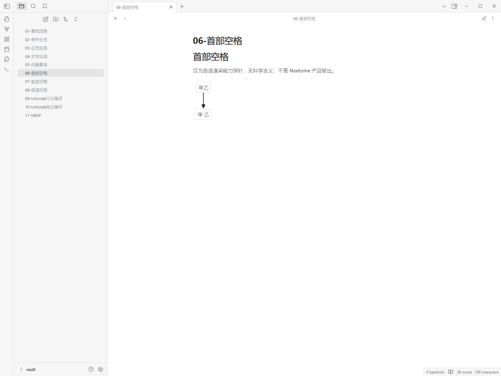
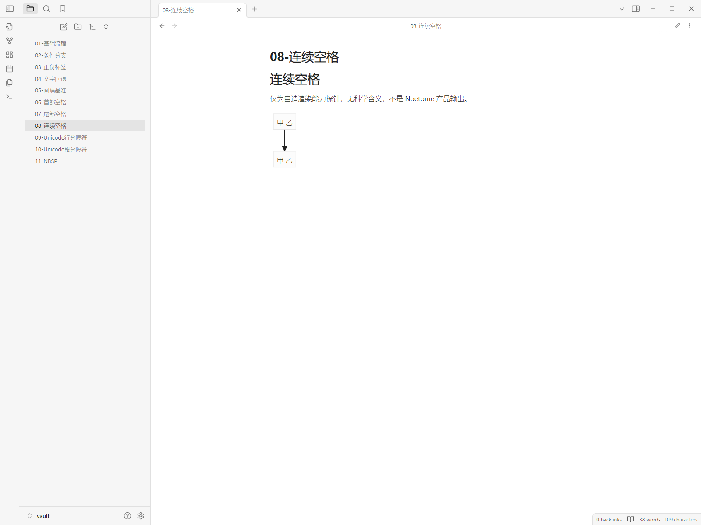
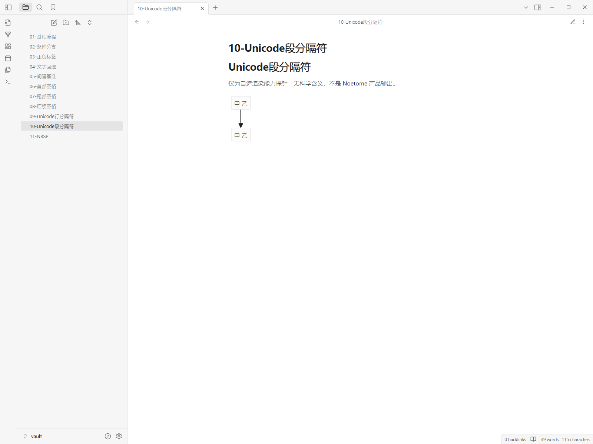
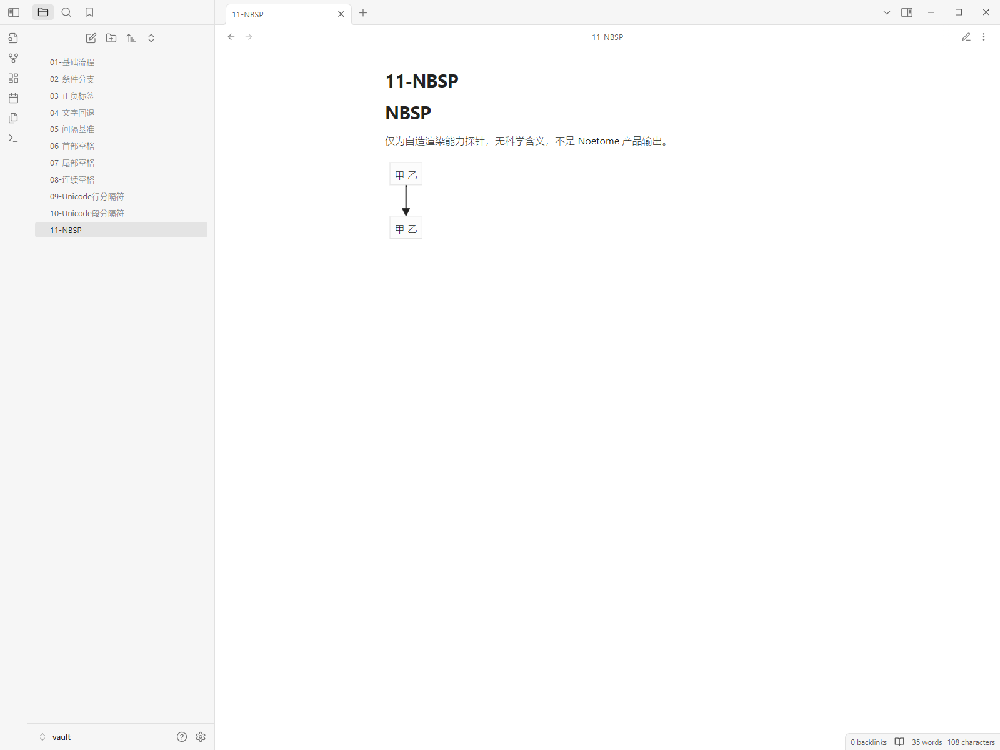

# Mermaid 标签空白的实际显示补探针

这是自造技术输入的补充观察，**不是 Noetome 流程图产品验收**。2026-11-05 在全新 Vault 和独立 profile 的 Obsidian 1.6.7 中完成 11 份笔记捕获，其中 4 份为顺序、分支、正负标签及文字回退基准，7 份用于比较空白。运行时为 Electron 30.1.2 / Chromium 124.0.6367.243，默认 `htmlLabels=true`、`white-space: nowrap`，无社区插件。Mermaid 10.6.1 的本机安装包版本依据沿用[已保存原件](../bundled-mermaid.json)。

每份空白探针都有一个待测节点和一个 `甲 乙` 对照节点。记录同时保存 DOM `textContent`、`innerText`、逐码点 Range 几何和原始截图，未用归一化空白后的相等值替代视觉核对。

| 自造节点标签 | 实际观察 |
| --- | --- |
| `甲 乙`，一个内部 ASCII 空格 | 保留码点和可见间隔；空格宽 4.3828125 CSS px |
| `  甲乙`，两个首部空格 | 首部空格被 Mermaid 去掉，DOM 已是 `甲乙` |
| `甲乙  `，两个尾部空格 | 尾部空格被 Mermaid 去掉，DOM 已是 `甲乙` |
| `甲  乙`，两个内部空格 | DOM 保留两个，`innerText` 只留一个；第二空格 Range 宽 0 |
| `甲\u2028乙`，Unicode 行分隔符 | DOM 和 `innerText` 保留 U+2028；两汉字仍处同一 y，分隔符宽等于普通空格，截图为一行 |
| `甲\u2029乙`，Unicode 段分隔符 | DOM 和 `innerText` 保留 U+2029；两汉字仍处同一 y，分隔符宽等于普通空格，截图为一行 |
| `甲\u00A0乙`，NBSP | 本单行例保留码点与间隔；全局 nowrap 环境不能证明其独立不换行行为 |

U+2028/U+2029 的节点高度与普通单空格例相同，均为 35.796875 CSS px；两汉字 Range 的 y 都为 268.4765625。因而仅检查 `innerText` 相等会漏掉行/段分隔意义的丢失。几何数值只描述本次视窗与字体。

有限编译建议是：图标签只允许内部单个 ASCII 空格；首尾空格、连续 ASCII 空格及其他 Unicode 空白采用保留原文的文字回退。这是一条保守支持边界，**不把 NBSP 的本次单间隔显示说成失败**，也不声称所有 Unicode 空白都逐一测过。此前 LF/Tab 折叠原件仍在[父探针](../README.md)中，未覆盖或重写。

[summary.json](summary.json)逐例保存观察及政策区别。[originals.zip](originals.zip)保存实际 DOM/SVG/PNG、全部测试 Markdown、打开前指纹、干净配置、启动与退出原件；[archive.json](archive.json)包含成员指纹，已全部重读核对。11 份 Markdown 运行后逐字不变，自有 PID 27960 和端口 59046 均确认退出；两次普通中文笔记链接实际点击成功。

[launch_probe.py](launch_probe.py)和[probe_capture.mjs](probe_capture.mjs)可在新的自有目录重放；[archive_probe.py](archive_probe.py)只归档已有完整运行，不重新打开 Obsidian。路径参数由本机显式提供：

```text
python launch_probe.py <new-work> <native-python> <installed-Obsidian.exe> <powershell.exe> <playwright-core-index.mjs>
python archive_probe.py <completed-work> <new-archive-directory>
```









