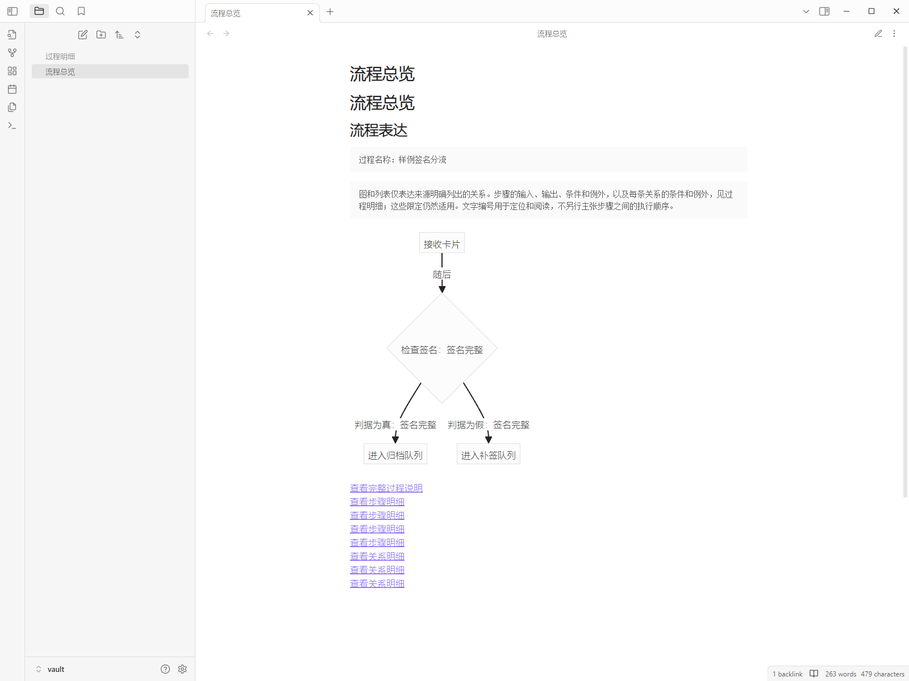
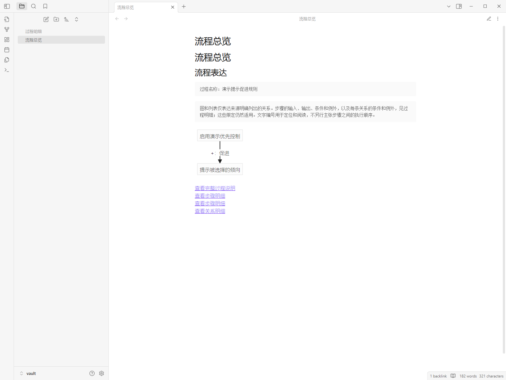
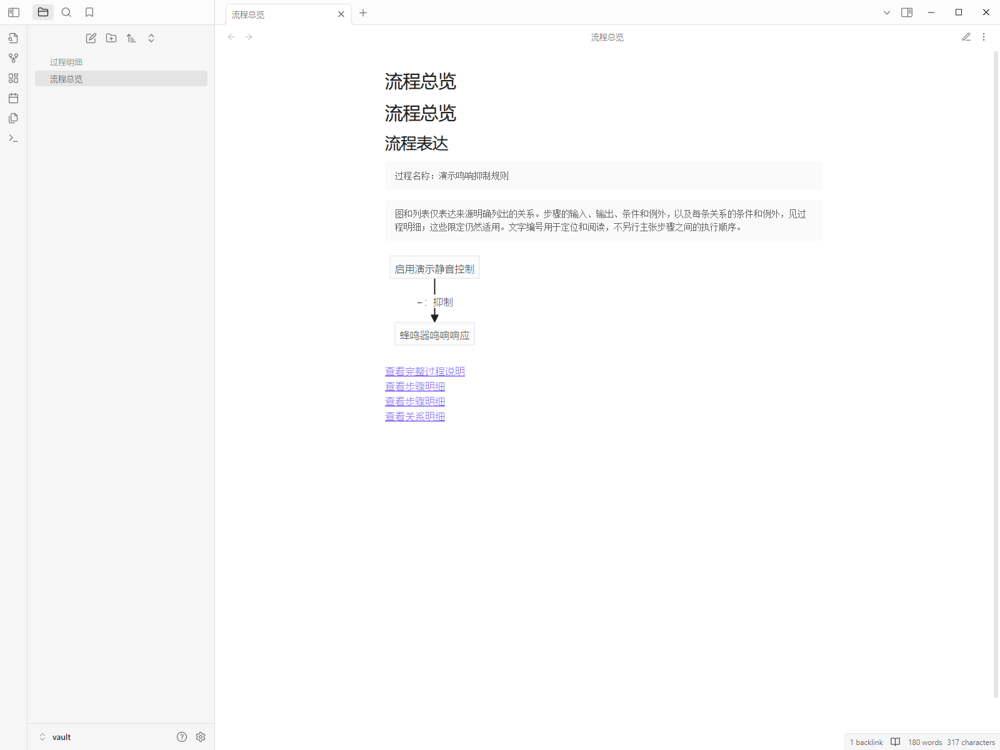
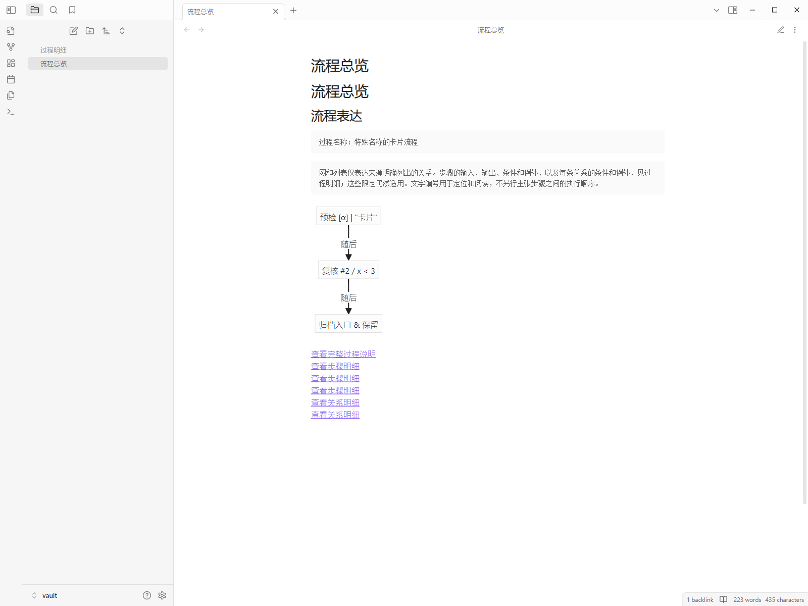
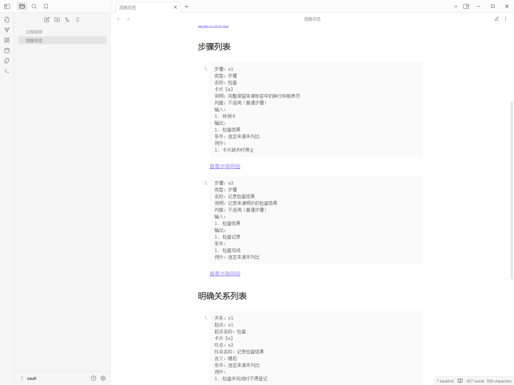
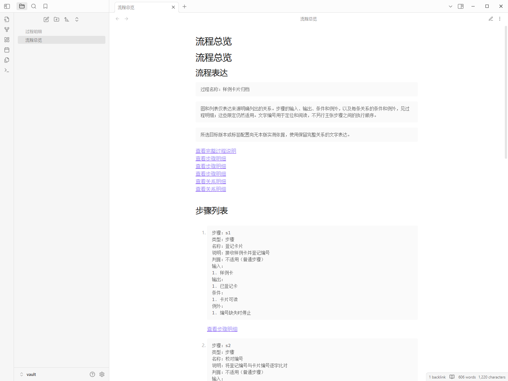
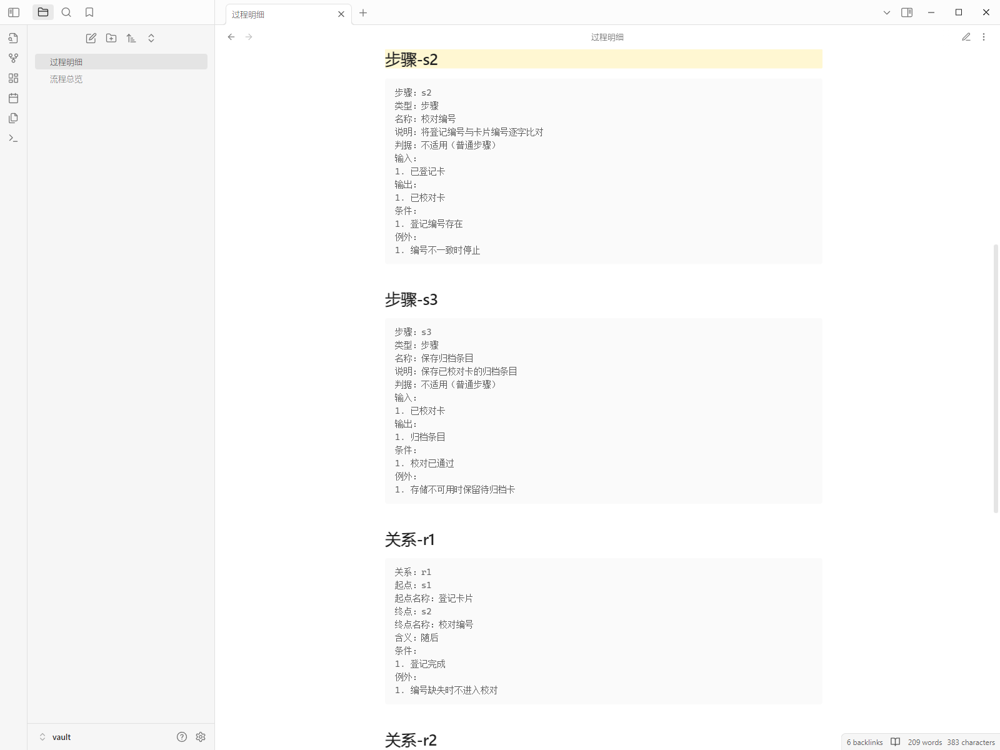

# 实际 Obsidian 流程与文字回退验收

2026-11-05 使用真实普通 CLI 从八份冻结作者文字来源重新执行项目登记、来源导入、`knowledge process-review` 和 `knowledge flow`，32 条命令全部成功。独立 Python 核对器在每个 Vault 打开前重新核对实际来源、gold、expected、计划、Markdown 和映射；只把实际生成的两份 Markdown 复制进各自全新的测试 Vault。没有把手写 Mermaid 能力探针当成产品输出。

实际安装版为 **Obsidian 1.6.7 / Electron 30.1.2 / Chromium 124.0.6367.243**，各自使用全新 `--user-data-dir`，社区插件为空。Mermaid 10.6.1 的本机安装包依据见[版本原件](../capability-probe/bundled-mermaid.json)。八个成功场景共验证 **16 份笔记、17 个图节点、11 条边、70 个完整预格式正文块、4 个有序列表的 8 个条目、60 次实际锚点点击**。

最终[原生来源联结](final-source-linkage.json)也已通过：固定源码 `3977ac70cbfc6d5caeb8ed5ce20e9b5fce5907e2` 的 Windows 六门全部为 0，最终 CLI SHA-256 为 `4117afb19b915b56bef501826b1666d7c2e685e9544e6804835970a44c87c169`。重新读回 1,873 个快照文件，并将最终原生审计的八例完整语义计划、冻结 expected 和 **16 份 Markdown** 与上述实际 Obsidian 副本逐字对照，全部相同。没有用早期 Linux 审计通过代替最终原生结果。

| 场景 | 实际表示与核对 |
| --- | --- |
| `linear` | 三步、两条“随后”边，明确端点和向下箭头；7 次链接点击 |
| `branch` | 四节点、菱形判定、三条边；真/假分支均保留原判据；9 次链接点击 |
| `causes` | 明示“导致”与后续顺序分开显示；7 次链接点击 |
| `promotes` | 正作用 `+：促进` 原样显示；5 次链接点击 |
| `inhibits` | Unicode 负号 `−：抑制` 原样显示；5 次链接点击 |
| `complex_labels` | 引号、方括号、竖线、`#`、`/`、`<`、`&` 等标签原字符可见；7 次链接点击 |
| `multiline_labels` | 文字回退，没有成功 SVG；两步、一关系的有序条目保留 LF/Tab；8 次链接点击 |
| `compatibility_fallback` | 未验证目标 profile 采用完整有据文字，保留回退说明；12 次链接点击 |

所有图节点和边从独立作者 expected 对照实际 SVG；核对生成节点 ID 对应关系、形状、文字、边的 `LS`/`LE` 端点、终点箭头、向下几何及可见正负/分支标签。正文的过程条件、目标、节点说明、输入输出、条件、例外以及关系限定逐块与已独立核对的计划原字符串相等，未归一化空白。

多行标签在总览列表和明细中共四处读取逐码点 Range：LF 前后的汉字位于不同 y，Tab 占有正宽度；原 `textContent` 和 `innerText` 相等。实际 DOM 为 `ol > li`，列表从 1 开始，标记样式为 decimal，每项包含对应预格式正文和明细链接。不是把普通段落看起来像编号便算作有序列表。

Obsidian 阅读视图会卸载不可见的长篇区块。脚本先实际滚动测量，再逐屏保存 DOM，按内容及文档位置合并；各节另外保存可见截图。链接验收使用真实鼠标点击，随后只观察目标文件和标题是否进入预览可见区，不替链接手动滚动到目标。坐标允许 1 CSS px 的滚动舍入误差，每次仍保存原始几何及点击后截图。

八个成功运行及五次未成功捕获的自有 PID、profile 进程和监听端口全部确认退出，均未使用紧急终止。源审计目录和复制的 Markdown 在前后逐字相同。失败路径的通用收尾代码也已加入，但没有把未实际触发的异常路径清理说成经过故障注入验收。

五次未成功捕获完整保留：最初两次因过严的锚点可见边界退出，后次记录显示标题已跳转并高亮，仅有 0.203125 CSS px 的舍入差；第三次单快照缺少已被虚拟化卸载的明细；第四次核心悬浮预览使全局选择器匹配两个视图；第五次初始截图在 30 秒超时。分别采用有限舍入容差、实际滚动读取、活动窗格选择器及自有页面前置/较长截图等待后，在新目录完成对应实测。没有改写失败目录，也没有把其中的局部通过计入最终八场景结果。

原件与重放入口：

- [summary.json](summary.json)：逐例身份、字节、独立核对、图/正文/列表计数、LF/Tab 几何、清理及失败历史。
- [originals.zip](originals.zip)：9,593,255 bytes，SHA-256 `e6380e0beacbe3d896ec46be43c0b36322ae33a3d706534e3c492b92caa5a394`，含 1,166 个输入、命令、DOM/SVG/截图、配置、清理和失败原件。已逐成员完成 CRC/SHA/长度读回。
- [archive.json](archive.json)：全部 ZIP 成员清单与指纹。Linux CLI 的本地原件路径及完整指纹留在来源回执，未以它冒充原生 Windows 二进制。
- [capture-roots.json](capture-roots.json)：八个真实成功目录及五个未成功尝试的位置，成功记录没有依赖原目录改名。
- [prepare_inputs.py](prepare_inputs.py)：从冻结作者通过普通 CLI 创建八份新输出。
- [run_capture.py](run_capture.py) 与 [capture_obsidian.mjs](capture_obsidian.mjs)：独立复验、创建新 profile/Vault、读取真实活动窗格、截图、点击及自有进程收尾。
- [archive_capture.py](archive_capture.py)：归档已有实测记录，不重新执行产品或伪造渲染。
- [link_final_source.py](link_final_source.py)：在最终 Windows 六门真实完成后，逐字核对原生 CLI 重新生成的 16 份 Markdown、完整语义计划和冻结 expected；[最终结果](final-source-linkage.json)已实际通过。

```text
python prepare_inputs.py <absolute-current-cli> <verify_process_flow.py> <new-input-root>
python run_capture.py <input-root> <case-name> <new-capture-root> <Obsidian.exe> <powershell.exe> <native-python> <playwright-index.mjs> --checker <verify_process_flow.py>
python link_final_source.py <completed-native-root> <capture-roots.json> <new-linkage.json>
```

这组有限工程样例的知识状态仍为 pending，科学质量为 not_run，发布为 false。实测只覆盖本机的一个 Obsidian/Mermaid 版本组合，不替代完整兼容矩阵、语义阻断/篡改矩阵或 NTFS/持有期保护验收。














