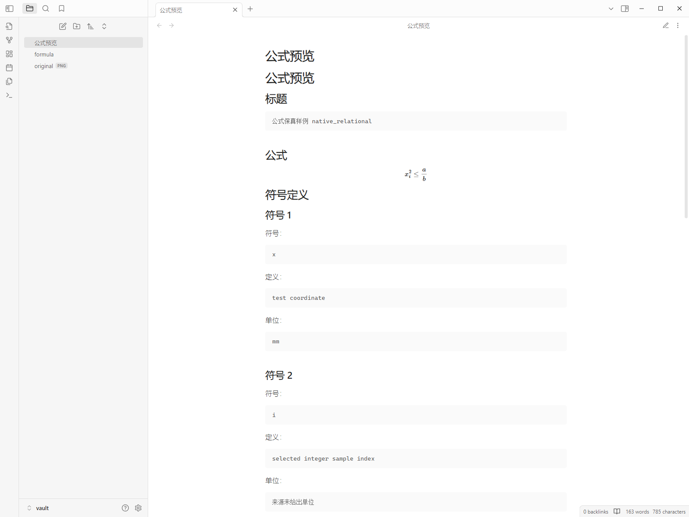
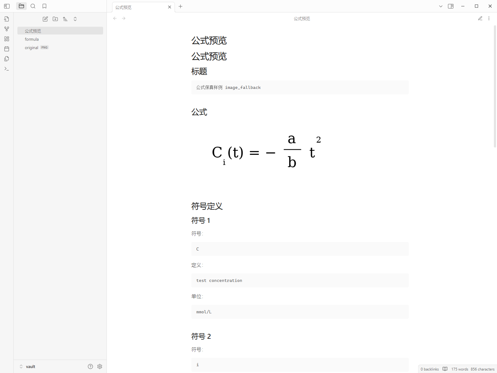
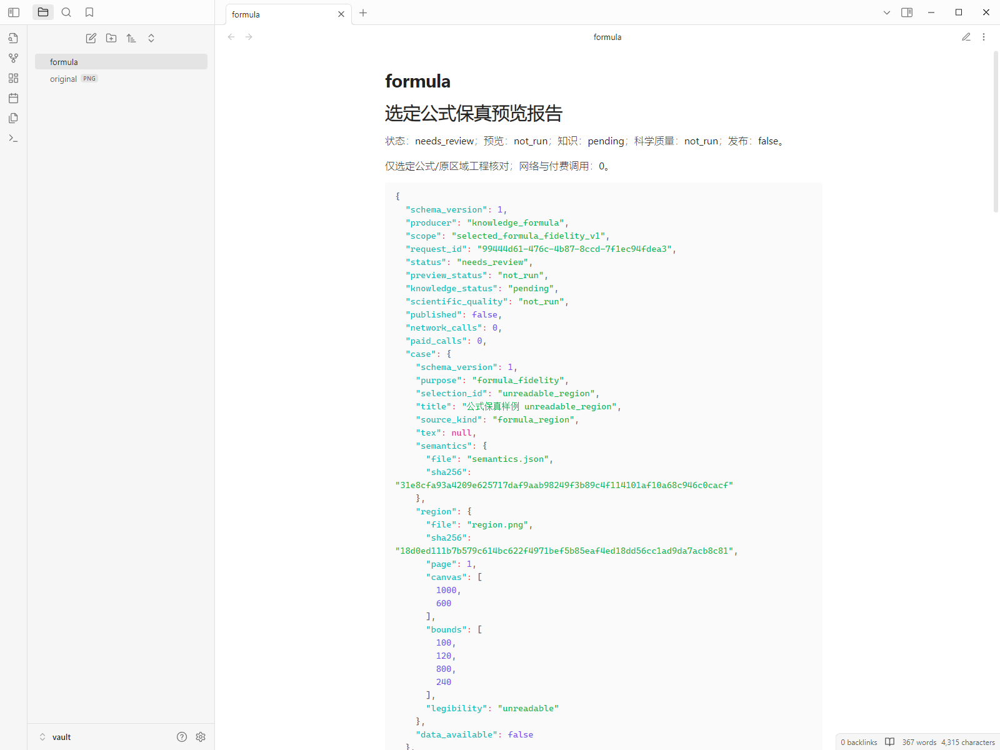

# 实际 Obsidian 公式与原图验收

本项实际打开了 **10 个普通 CLI 产物场景**：4 个原生 MathJax 公式、3 个公式原图回退和 3 个语义阻断报告。使用本机安装的 **Obsidian 1.6.7 / MathJax 3.2.2 / Electron 30.1.2 / Chromium 124.0.6367.243**；每次使用全新的测试 Vault 和 `--user-data-dir`，社区插件为空。没有读取用户 Vault，也没有用手写探针冒充产品输出。

| 场景 | 实际核对 |
| --- | --- |
| native | `C_i(t)=-a/b·t²` 的负号、下标、分子/分母及上标位置；原始 CRLF TeX 字节保留 |
| native_relational | `x_i² ≤ a/b` 的变量、上下标和关系方向 |
| native_exp | `C_i(t)=C_0 exp(-kt)` 的两个下标、函数名、负号及函数应用标记 |
| compatibility | 原始 `\dfrac` 单独保留，另存 `\frac` 编译表达，数学树相同 |
| image_fallback | 原生能力关闭时使用明确原区域的 PNG；没有成功 MathJax 节点 |
| region_only | 仅有原区域时使用图片，未把作者手工注释当成恢复的作者 TeX |
| compatibility_disabled | 关闭编译器受控规范化策略时使用原图，不声称 MathJax 缺少 dfrac 支持 |
| unknown_symbol | 实际打开 `needs_review` 报告，保存原件，没有 plan、compiled.tex 或成功公式笔记 |
| unreadable_region | 实际打开不可辨原区的阻断报告，保存附件，未生成成功表达 |
| curve_no_data | 实际打开无原始数据的曲线保护报告，没有虚假重绘或成功公式笔记 |

四个原生公式实际读取 **44 个可见 glyph**，逐个具有正面积；指数函数还有一个预期的不可见 U+2061 函数应用标记。原生 CHTML 的数学结构与手工从冻结公式写出的独立树对照，保留负号、关系、分式参数和上下标。脚标位置按可见 glyph 包围盒核对，分子在分母上方。没有把 inline wrapper 的行盒位置当成字符位置。

所有成功公式中的 **33 组符号**及完整单位、前提、范围和例外均已核对。[字段归组审计](native-label-association.json)还独立解析真实保存的 DOM，要求连续的“符号 n → 符号标签及值 → 定义标签及值 → 单位标签及值”结构，并核对前提、范围和例外位于各自小节，不通过扁平的字符串集合判断归属。Obsidian 会卸载不可见区块，因此采集先实际滚动测量，再逐屏保存 DOM；所用数据都是已显示的原生 DOM。

七个成功公式都执行了 **真实鼠标点击原始 PNG 附件**，核对目标文件在原生 image 视图打开，保存点击后截图。三种图片回退还核对 `original.png` 的本地 URL、完整加载、原始自然宽高及正面积。TeX 原件逐字保存，链接可在原生 metadata cache 中解析到对应本地文件；本项没有启动系统默认 TeX 查看器。

打开前，普通 CLI 输出先经独立核对器验证，然后仅将明确产物复制进新测试 Vault。原生应用进程再次读取这些明确文件并计算 SHA-256/长度，来源、复制品及原生读取的字节全部相同。打开后未改动源输出或复制的内容文件。[最终校验联结](final-checker/final-checker-linkage.json)使用最终独立核对器再次验证实际采集所用的 10 份源输出，同时重新读回副本和原生指纹；全部通过。不可变 CLI 快照 SHA-256 为 `3ba44b110ea0b92f684da9bc55fcaa010b62b6bc1bcbf8f443291da0004cf21e`，不受后来 Cargo 构建更新 `target/debug/noetome` 影响。

失败历史完整保留：

- 第一次输入准备只复制 expected 文件，独立核对器因缺少完整冻结作者清单拒绝；改为复制完整明确作者样例后重新生成新输出。
- 第一次能力探针使用 IPv4 `127.0.0.1` 无法从本机 WSL 访问已确认存活的自有端口；`localhost` 可访问同一个 PID。对同一个实例重新连接后发现默认没有 assistive MathML，改用真实可见 CHTML。随后旧版本断言失败，因为实际 MathJax 核心为 3.2.2，而辅助模块保留 3.2.1 字符串。完整修正后的新能力探针通过，也实际确认引擎支持 dfrac。
- 第一轮 10 个产品采集中，3 个阻断报告通过；其他场景因采集器未滚动到已被卸载的附件链接，或未处理 CHTML 组合脚标布局及隐式函数应用标记而失败。
- 第二轮只重跑 7 个必要场景，5 个通过；native 和 compatibility 因采集器误用 inline wrapper 行盒检查上标位置失败。改用实际 glyph 包围盒后，只在新目录重跑这两例，全部通过。

19 次产品实例和 3 次能力探针实例的自有 PID、监听端口及 profile 进程全部确认结束。10 个最终采纳的实例均正常退出；一个初始失败的 compatibility 实例在 350 ms 的退出等待后仍存活，收尾仅终止了其 PID 和经过命令行核对的自有 profile。没有终止其他 Obsidian 实例，也没有把失败的局部结果计入最终通过数。

真实证据入口：

- [summary.json](summary.json)：10 例身份、原件指纹、数学/附件计数、前后保护、全部失败及清理记录。
- [capture-roots.json](capture-roots.json)：实际成功和失败目录，未通过改名替代新一轮实测。
- [originals.zip](originals.zip)：1,570 个源输入、命令、配置、DOM/CHTML、截图和清理原件；SHA-256 `0abb8c4da444d7783a56fb150271c3bf3d2b4ab04b2efa0a32c907ef50bdb500`，3,477,775 bytes。逐成员 CRC、SHA 和长度已读回验证，清单见 [archive.json](archive.json)。应用缓存与可重建的 CLI 二进制没有打包，二进制指纹保存于命令及来源回执。
- [bundled-mathjax-core.json](bundled-mathjax-core.json)：安装 ASAR 内真正的核心 `VERSION=3.2.2` 导出和完整成员指纹。最初辅助字符串的误判另存于 [bundled-mathjax.json](bundled-mathjax.json)，不以旧记录证明运行时版本。
- [prepare_capture.py](prepare_capture.py)、[launch_capture.py](launch_capture.py)、[capture_formula.mjs](capture_formula.mjs)、[run_suite.py](run_suite.py)：不可变 CLI、独立先验核对、隔离实例、真实滚动/点击及自有收尾。
- [verify_capture_metadata.py](verify_capture_metadata.py)、[link_final_checker.py](link_final_checker.py)：真实 DOM 字段归组与最终核对器联结。
- [review.md](review.md)：本任务 Rust 代码及契约的独立审查。

```text
python prepare_capture.py <absolute-immutable-cli> <verify_formula.py> <formula-fidelity-fixture-root> <new-input-root>
python run_suite.py <prepared-input-root> <new-capture-root> <native-python> <Obsidian.exe> <powershell.exe> <playwright-index.mjs>
python verify_capture_metadata.py <capture-roots.json> <new-label-audit.json>
python link_final_checker.py <capture-roots.json> <verify_formula.py> <repo-root> <new-linkage-root>
```

此验收覆盖一个本机版本组合和明确作者样例，知识仍为 pending、科学质量为 not_run、发布为 false。一般图片知识抽取、扫描 OCR、任意 PDF 作者源码恢复和完整发布兼容矩阵不由本项证明。







