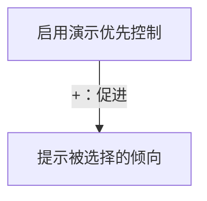

# 流程总览

## 流程表达

```text
过程名称：演示提示促进规则
```

```text
图和列表仅表达来源明确列出的关系。步骤的输入、输出、条件和例外，以及每条关系的条件和例外，见过程明细；这些限定仍然适用。文字编号用于定位和阅读，不另行主张步骤之间的执行顺序。
```



[[过程明细#过程说明|查看完整过程说明]]
[[过程明细#步骤-s1|查看步骤明细]]
[[过程明细#步骤-s2|查看步骤明细]]
[[过程明细#关系-r1|查看关系明细]]

